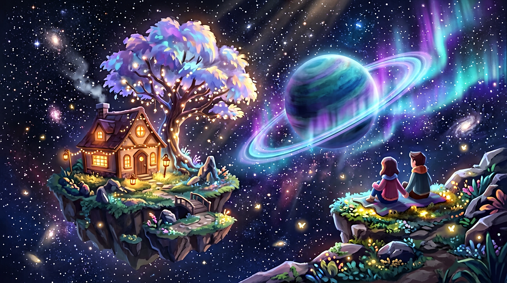
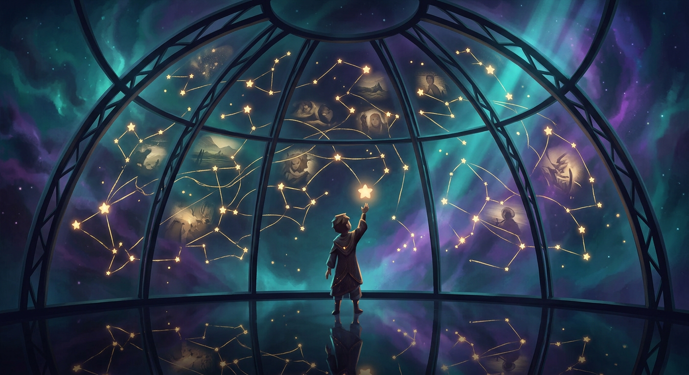
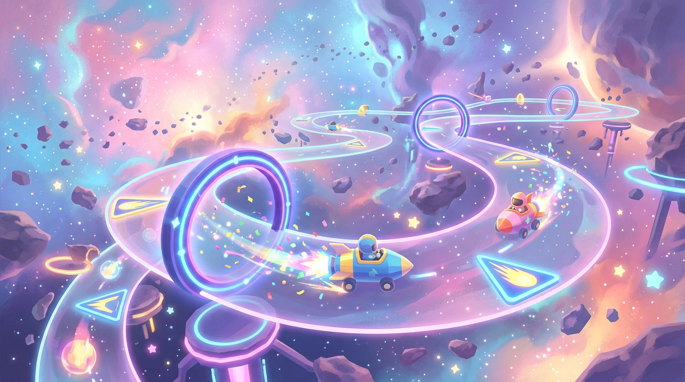
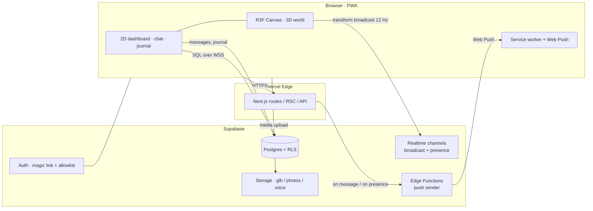
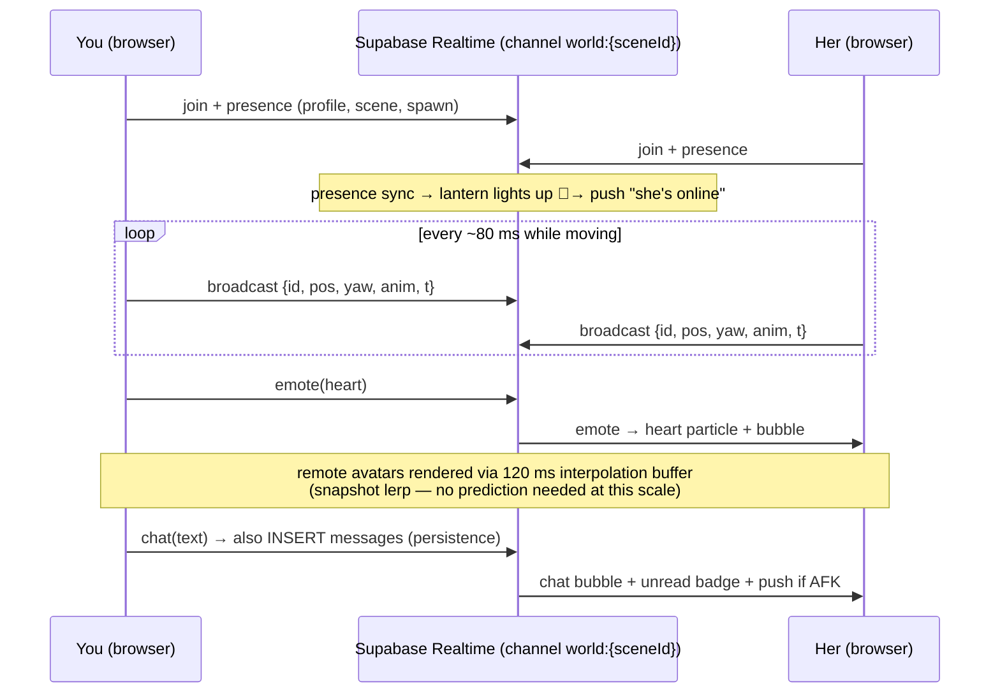
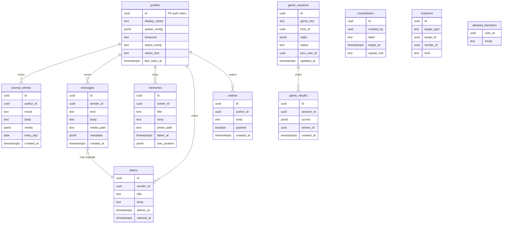

# 🌌 Project ORBIT — Blueprint & Plan

> **A private, metaverse-style portal for two.** A dreamy corner of space where you and your
> partner walk around as avatars, talk, leave notes for each other, keep memories among the
> stars, and play little games — no one else is invited, ever.
>
> **Codename:** `ORBIT` · **World name:** *The Hearth* (rename freely — it's yours)



---

## 1. Vision

Long-distance means the hard part isn't love — it's **shared presence**: doing nothing *together*,
having a place that is unmistakably *ours*. ORBIT is a tiny persistent 3D world that lives in the
browser and is shared by exactly two accounts. You can drop in for 30 seconds to say hi with an
emote, or hang out for an evening stargazing and playing a game.

### Product pillars (every feature must serve at least one)

| Pillar | Meaning |
| --- | --- |
| **Presence** | I can *feel* when she's around — and leave traces when she isn't. |
| **Ritual** | The world gives us small daily reasons to visit (status, countdowns, letters). |
| **Memory** | Our history accumulates *inside the world* — photos become constellations, wishes grow on a tree. |
| **Play** | We laugh together — co-op and versus mini games. |
| **Privacy** | Two accounts. Hard-locked. No feeds, no strangers, no tracking. |

### Non-goals (v1)

- ❌ Public/social features, friend lists, discovery
- ❌ User-generated building tools (fixed, hand-authored world)
- ❌ Voice/video chat (Phase 6+ via WebRTC — see backlog)
- ❌ Native mobile apps (PWA instead)

---

## 2. Feature catalogue

### 🌍 The World — *The Hearth*
- One continuous **hub island** in space + **warp portals** to activity scenes (keeps mobile perf sane via scene streaming).
- **Co-presence:** both avatars in the same scene in real time, walk animations, name tags, emotes (wave, heart, dance, sit together).
- **Ambience:** day/night sky, aurora, shooting stars, spatial audio (soft pads, chimes).
- **Interactive props:** campfire (sit → slow "on this day" memory rotation), telescope (peek at partner's *local time & sky* — her moon shows her time of day), mailbox, jukebox (shared queue of "our songs"), wish tree.
- **Asynchronous traces:** footprints of the last visit, a lantern that lights up when the partner is online, bottle-messages drifting by.

### 🧑‍🚀 Avatars
- Stylized low-poly glTF avatar, **fully customizable**: body tint, hair style/color, outfit colors, accessories (antenna, scarf, crown, cat hood…).
- Editor at `/settings` with live 3D preview; config stored as JSON on the profile.
- Animation set: `idle / idle_talk / walk / run / wave / dance / sit / hug` (hug triggers only when both avatars are close — proximity-gated interaction).
- Skins/outfits unlockable as easter eggs inside the world (e.g. reach the far asteroid).

### 💬 Communication
- **In-world chat:** speech bubbles above avatars + scrollable chat drawer.
- **2D chat room** (`/chat`) for when you're on your phone and don't want 3D — same thread, same history.
- **Voice notes & photos** in chat (recorded in-browser, stored as media).
- **Read receipts + typing indicator** via Realtime presence.
- **Letters in bottles** (`/letters`): asynchronous mail — write a letter that arrives at a chosen future moment (or random "whenever you miss me" delivery).

### 📖 Personal updates — *The Journal*
- Daily status: mood emoji + short text + optional photo ("captain's log").
- Partner sees your latest log as a **hologram in the hub** and gets a push notification.
- Reactions (heart, hug sticker) on each entry; streak counter ("you've shared 42 days in a row").

### ✨ Rituals & memory
- **Countdowns:** "days until I see you" — rendered as a glowing countdown crystal in the hub + widget on the 2D dashboard.
- **Shared calendar:** important dates, timezone-aware (shows in *both* your local times).
- **Memory Planetarium** (`/memories`): upload photos + stories; each becomes a **star in a private constellation** inside a dome scene. Click a star → the memory opens.



- **Wish tree:** leave wishes; the tree glows brighter as wishes accumulate.

### 🎮 Mini games (Arcade scene — *The Asteroid Belt*)
| Game | Mode | Type | Phase |
| --- | --- | --- | --- |
| **Deep Space Questions** — card deck of prompts, streaks & saved answers | co-op | turn-based, DB-backed | 4 |
| **Cosmic Memory Match** — pairs game using *your own photos* | versus / co-op | real-time light | 4 |
| **Constellation Pictionary** — draw with stars, partner guesses | versus | turn-based | 4 |
| **Comet Dodge** — co-op endless dodger, shared score, weekly best | co-op | real-time arcade | 4 |
| **Astro Putt** — mini golf on asteroids (physics) | versus | physics, host-authoritative | 5 |
| **Ring Race** — rocket race through checkpoint rings | versus | physics, host-authoritative | 5+ |



- Scores persist; a **trophy shelf** in the hub shows all-time records.

### 📱 Shell & platform
- **PWA**: installable to home screen, offline shell, **Web Push notifications** (message arrived / partner came online / letter landed).
- **2D dashboard** (`/`) for phone-first use: latest journal, unread chat, next countdown, "partner is sleeping / awake" indicator (from timezones).
- Everything timezone-aware: store UTC, render both local times ("for her it's 9:12 AM ☀️").

---

## 3. Art direction & design system

**Mood words:** dreamy · intimate · weightless · warm-in-the-dark.

- **Palette:** deep space navy `#0B1026` → indigo `#1B1F3B`; accents: aurora teal `#5EEAD4`, violet `#A78BFA`, warm lantern gold `#FBBF24`. Neutrals kept warm-grey, never pure black.
- **Shapes:** soft rounded forms, low-poly geometry, chunky silhouettes; avoid hard realism.
- **Light as emotion:** warm light = togetherness (lanterns, campfire, wishes); cool light = distance (starfield, her-side sky). The whole world reads through warm/cool contrast.
- **Motion:** everything floats a little (sine bobbing), slow easing (springs, no linear), particles over effects (fireflies, stardust trails on run).
- **UI:** glassy dark panels, large rounded corners, `Inter`/`Outfit` type, shadcn/ui tokens themed to the palette. UI never blocks the scene: side drawers + bottom sheets on mobile.
- **Audio:** ambient synth pads, UI blips, one shared "song of the day" slot in the jukebox.
- **Accessibility:** reduced-motion mode (kills bobbing/particles), colorblind-safe accent pair, subtitles for audio cues, low-power mode ( disables post-processing, halves resolution).

---

## 4. Technical architecture

### 4.1 Stack (chosen for: pro velocity, 2-user scale, $0 running cost)

| Layer | Choice | Why |
| --- | --- | --- |
| Framework | **Next.js 15 (App Router) + TypeScript** | One codebase for 3D app, 2D dashboard, API routes; Vercel-native |
| UI | **Tailwind CSS + shadcn/ui**, `framer-motion` | Fast, consistent design system |
| 3D | **React Three Fiber** + `drei` + `@react-three/postprocessing` | R3F is the fastest way to a maintained, declarative Three.js app |
| Physics | **@react-three/rapier** | Kinematic character controller, golf/race games later |
| State | **Zustand** (client) + **TanStack Query** (server state) | Small, testable, no boilerplate |
| Backend | **Supabase** — Auth, Postgres + RLS, Realtime, Storage, Edge Functions | Already in your toolbelt; realtime channels give presence/broadcast out of the box |
| Hosting | **Vercel** (Hobby) + Supabase free tier | ~$0/month at 2-user scale |
| Assets | Blender → **glTF + Draco/meshopt, KTX2 textures**; audio: `howler.js` | Industry pipeline, tiny payloads |
| Notifications | **Web Push (VAPID)** + service worker | Free, no app store |
| Testing/CI | **Vitest**, **Playwright** (multi-context netcode tests), GitHub Actions → Vercel preview | Keep the fun refactorable |

**Auth model:** magic-link email sign-in gated by an `allowed_members` allowlist (exactly 2 rows).
No passwords, no OAuth surface area. RLS enforces the 2-person boundary at the database layer —
the *only* two principals that can ever read or write anything are you two.

### 4.2 System diagram



### 4.3 Netcode model (co-presence + games)

Scale is 2 concurrent users — **never build a dedicated game server**. Client-authoritative with
*host-elected* authority for physics games:



- **Movement sync:** each client owns its avatar transform; others interpolate. Tolerates 200–400 ms RTT gracefully.
- **Turn-based games:** state in Postgres (`game_sessions.state` jsonb), moves via UPDATE, Realtime relays the row.
- **Physics games (Arcade, phase 5):** host = earlier `presence.join_time`; host simulates (Rapier) and broadcasts snapshots at 20 Hz; guest sends inputs at 20 Hz; desync watchdog → re-seed.
- **Region choice:** pick the Supabase region closest to the *midpoint* of you two (you're in Vancouver → `us-west` or `central` likely optimal). One Supabase project, pinned once.

### 4.4 Scene streaming & the 3D app structure

- One continuous hub island (~150×150 units) + **warp portals** that lazy-load activity scenes as separate modules (`import()` per scene). Only one scene is mounted at a time → predictable mobile memory.
- Each scene is a self-describing module: `{ id, spawnPoints, colliders, interactables, ambience, preloadManifest }`.
- Quality tiers auto-selected by `navigator.hardwareConcurrency` + device memory + FPS probe: `high / medium / low` (post-processing, particle counts, pixel ratio 2 / 1.5 / 1, shadow on/off).

```
src/
├── app/                    # Next.js routes
│   ├── (auth)/             # magic-link sign-in
│   ├── world/              # the 3D experience (canvas shell)
│   ├── (2d)/               # dashboard, chat, journal, memories, letters, rituals, settings
│   └── api/                # route handlers (push subscribe, uploads signing…)
├── features/
│   ├── world/
│   │   ├── core/           # Canvas, loaders (draco/ktx2), quality manager, input router
│   │   ├── player/         # controller: WASD+mouse / joystick+tap-to-move
│   │   ├── net/            # presence, transform broadcast, interpolation, emotes
│   │   ├── avatars/        # avatar rig, customization mapping, animation FSM
│   │   ├── scenes/         # hub/ · planetarium/ · arcade/ · pier/ (lazy modules)
│   │   └── props/          # campfire, telescope, mailbox, jukebox, wish tree, portals
│   ├── chat/  journal/  memories/  letters/  rituals/  games/
│   └── push/
├── lib/                    # supabase clients, stores, time/timezone utils, audio
├── db/                     # migrations + seeds
└── supabase/               # config.toml, edge functions (push)
public/                     # PWA manifest, icons
assets-src/                 # Blender sources (not shipped), exported glb in public/world/
```

### 4.5 Data model



**Security is the schema.** Example RLS pattern — applied to *every* table:

```sql
alter table messages enable row level security;

create policy "only the two of us"
  on messages for all
  using (auth.uid() in (select user_id from allowed_members))
  with check (auth.uid() in (select user_id from allowed_members));
```

Storage buckets (`media/`, `avatars/`, `world/`) get equivalent policies; `world/` (static scene
assets) is public-read for CDN caching — it contains no personal data.

**Sync of chat:** INSERT into `messages` → Supabase Realtime `postgres_changes` relays the row to
the partner's open socket → UI renders bubble/push. History loads once via range query on mount.

### 4.6 Performance budgets (enforced in CI)

| Budget | Target |
| --- | --- |
| 2D shell initial JS | < 250 KB gz |
| 3D world lazy bundle (per scene incl. assets) | < 2.5 MB gz, textures KTX2, meshes Draco |
| Frame rate | 60 fps desktop · ≥ 30 fps mid-range phone |
| Time-to-interactable (world) | < 5 s on 4G |
| Realtime uplink | ≤ 15 msg/s while moving, 0 idle |

Lighthouse CI on PRs; Playwright `twoContexts.spec.ts` proves presence, chat, and emotes round-trip between two browser contexts.

---

## 5. Roadmap

Timeboxes assume evenings/weekends pace; each phase ends **deployed and usable by both of you** — no phase is "internal only".

### Phase 0 — Foundations *(week 1)*
- Repo scaffold (above layout), CI (lint, typecheck, Vitest, Playwright smoke), Vercel + Supabase projects wired.
- Auth: magic link + allowlist, `/` redirects, PWA manifest, base theme.
- DB migrations for all tables + RLS; seed the two of you as members.
- ✅ *Done when:* both accounts sign in; nothing else exists yet; CI green on PR.

### Phase 1 — The World MVP *(weeks 2–4)* — the star of v1
- Hub island scene (gravity, collisions via Rapier kinematic controller), third-person camera.
- Cross-input player controller: WASD + mouse orbit (desktop), virtual joystick + drag camera (mobile), tap-to-move fallback.
- Avatar system: one rigged base + customization → applies from `profiles.avatar_config`.
- Realtime co-presence: transform broadcast at 12 Hz, interpolation, name tags, **emotes** (wave/heart/sit).
- 2–3 interactables: campfire (sit), telescope (partner's local time), lantern (online indicator).
- ✅ *Done when:* you two can be in the hub simultaneously from a laptop and a phone, see each other move in < 200 ms, and emote at each other.

### Phase 2 — Communication *(weeks 5–6)*
- Chat: in-world bubbles + `/chat` 2D room, history, media (photos/voice notes), receipts, typing indicator.
- Web Push: new message / partner online; service worker; unread badges on dashboard.
- Journal v1 (`/journal` + hub hologram).
- ✅ *Done when:* she sends a voice note from her phone and your watch buzzes.

### Phase 3 — Rituals & memory *(weeks 7–8)*
- Countdowns + shared calendar (timezone dual-render).
- Memory Planetarium scene: photo upload → star placement → clickable constellation.
- Letters in bottles; wish tree.
- ✅ *Done when:* your next visit date glows in the hub and her first photo-star exists.

### Phase 4 — Arcade wave 1 *(weeks 9–10)*
- Games framework (session lifecycle, matchmaking for 2 = trivial, score persistence, trophy shelf).
- Ship **Deep Space Questions**, **Cosmic Memory Match**, **Comet Dodge**.
- ✅ *Done when:* a game night happens and the trophy shelf records it.

### Phase 5 — Polish & waves *(ongoing)*
- Astro Putt (physics), Constellation Pictionary; seasonal events (aurora on anniversaries, meteor shower on day 100); audio pass; quality-tier tuning; hug animation.

### Phase 6+ — Backlog (see §8)

---

## 6. Risks & mitigations

| Risk | Mitigation |
| --- | --- |
| **Scope creep** (the classic solo-project killer) | Phase gates above are shippable cuts; backlog is a parking lot, not a plan. No new feature enters a phase. |
| Mobile GPU/memory limits | Scene streaming, quality tiers, KTX2/Draco budgets, FPS probe auto-downgrade. |
| Avatar pipeline effort (rigging/animation) | Use a proven rig (Mixamo-compatible humanoid or Quaternius-style base); animations bought/mixed, not hand-keyed. Hug = the only bespoke animation in v1. |
| Supabase Realtime quotas | 2 users ≈ negligible traffic; still: batch transform broadcasts, no idle heartbeat beyond presence. |
| Timezone bugs (her 3 AM ≠ your 3 PM) | Store UTC everywhere; single `useDualTime()` hook; "quiet hours" suppression for pushes. |
| Motivation decay over months | Every phase ends with something *she* can use; ship weekly. The world itself is the motivation. |
| Data loss of memories | Supabase PITR off on free tier → nightly `pg_dump` + storage sync to a private repo artifact or Cloudflare R2. |

---

## 7. Running cost (steady state)

| Item | Cost |
| --- | --- |
| Vercel Hobby | $0 |
| Supabase Free (500 MB DB / 1 GB storage / realtime) | $0 |
| Web Push (VAPID) | $0 |
| Domain (optional, e.g. `our-orbit.app`) | ~$12/yr |
| **Total** | **≈ $1/month** |

Upgrade triggers (only if ever needed): Supabase Pro for PITR & 8 GB storage (~$25/mo) — not before year 2 at this usage.

---

## 8. Future backlog (post-v1 ideas, unordered)

- **WebXR mode** — the same world in VR via `@react-three/xr` (Quest browser).
- **Voice/video "call portal"** — LiveKit/Daily WebRTC room opened at the campfire.
- **Procedural "our sky"** — real star chart of the night sky over *her* city, rendered live.
- **AI shooting star** — a tiny comet that occasionally whispers a prompt ("ask her about her first concert") — local LLM or scheduled prompt deck.
- **Capacitor wrap** for App Store/Play presence; iOS widgets for countdown & status.
- **Photo-to-3D memories** — turn a photo into a floating diorama in the planetarium.
- **Shared garden** — slow co-op: plant a seed today, it blooms when you next meet.
- **Anniversary time capsule** — scene locks for a year, opens on your anniversary with everything saved inside.

---

## 9. Next actions (start here)

1. ☐ Create Supabase project (region = midpoint of you two) + Vercel project linked to this repo.
2. ☐ Scaffold Phase 0 (I can generate the full Next.js + Supabase skeleton next).
3. ☐ Pick avatar base asset (I can shortlist 3 candidate rigs).
4. ☐ Block 2 hours with *her* to pick: world name, island layout, her avatar — co-design is half the romance of this project.

> **Principle of the whole plan:** ship the world early, let it grow around your relationship —
> not the other way around.
